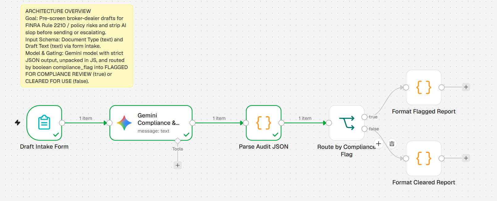

# Anti-Slop & Compliance Auditor (n8n + Gemini)

An automated pre-screening workflow built in **n8n** and powered by **Google Gemini** to audit broker-dealer communications before they are sent or escalated. It enforces regulatory guardrails (FINRA Rule 2210), strips AI-generated clichés (AI SLOP), and routes drafts into structured human-review or cleared-for-use paths.

## Business Problem

Teams using generative AI to draft client emails, internal memos, and investor updates face two recurring risks:
1. **Regulatory & Policy Exposure:** Unverified performance promises, guarantees, or misleading claims that violate FINRA Rule 2210.
2. **Brand Dilution:** Repetitive AI filler phrases (such as DELVE, FAST-PACED LANDSCAPE, and GAME-CHANGING) that erode client trust.

Manual first-pass reviews are slow and inconsistent. This workflow acts as an automated quality-control gate before any draft reaches a client or a compliance officer.

## Workflow Architecture

1. **Draft Intake Form (n8n Form Trigger):** Captures standardized inputs: Document Type (Client Email, Internal Memo, Investor Update) and Draft Text.
2. **Gemini Compliance & Slop Audit (Google Gemini Node):** Evaluates the draft against FINRA Rule 2210 and anti-slop rules, with strict JSON output enforced.
3. **Parse Audit JSON (JavaScript Code Node):** Unpacks the model response into discrete fields (`compliance_flag`, `risk_reasons`, `slop_removed`, `clean_rewrite`) using a defensive regex strip to guard against unexpected markdown code fences.
4. **Route by Compliance Flag (If Node):** Evaluates the strict Boolean `compliance_flag` (TRUE or FALSE) rather than fragile text strings.
5. **Dual Output Formatters (JavaScript Code Nodes):**
   - **TRUE Branch (Format Flagged Report):** Packages a scannable `FLAGGED FOR COMPLIANCE REVIEW` packet listing specific risk reasons, removed clichés, and a compliant rewrite.
   - **FALSE Branch (Format Cleared Report):** Outputs a clean `CLEARED FOR USE` report ready for immediate use.

## Defensive Engineering Highlights

- **Strict Boolean Gating:** Enforcing a native Boolean (`true` / `false`) for `compliance_flag` eliminates routing failures caused by inconsistent LLM capitalization or punctuation.
- **Native JavaScript Parsing:** Running JSON parsing natively in Node.js avoids Python sandbox cold-start latency in n8n and keeps expression syntax uniform across the workflow.
- **Fence-Safe JSON Handling:** Pre-processing the raw model output before `JSON.parse()` prevents runtime crashes if the LLM wraps its JSON payload in markdown backticks.
- **Self-Documenting Canvas:** All nodes are explicitly named and paired with an on-canvas Architecture Overview sticky note for team maintainability.

## How to Import & Test

1. Download the `.json` workflow file from this repository.
2. In n8n, open a new workflow, click the top-right menu (`...`), and select **Import from File**.
3. Open the **Gemini Compliance & Slop Audit** node and attach your Google Gemini API credentials (credentials are automatically stripped on export).
4. Click **Execute workflow** and submit a test draft via the pop-up form:
   - **Flagged Test:** Include phrases like GUARANTEED, RISK-FREE, or DELVE to verify the TRUE branch.
   - **Cleared Test:** Submit a neutral, factual update referencing a prospectus or fee schedule to verify the FALSE branch.
